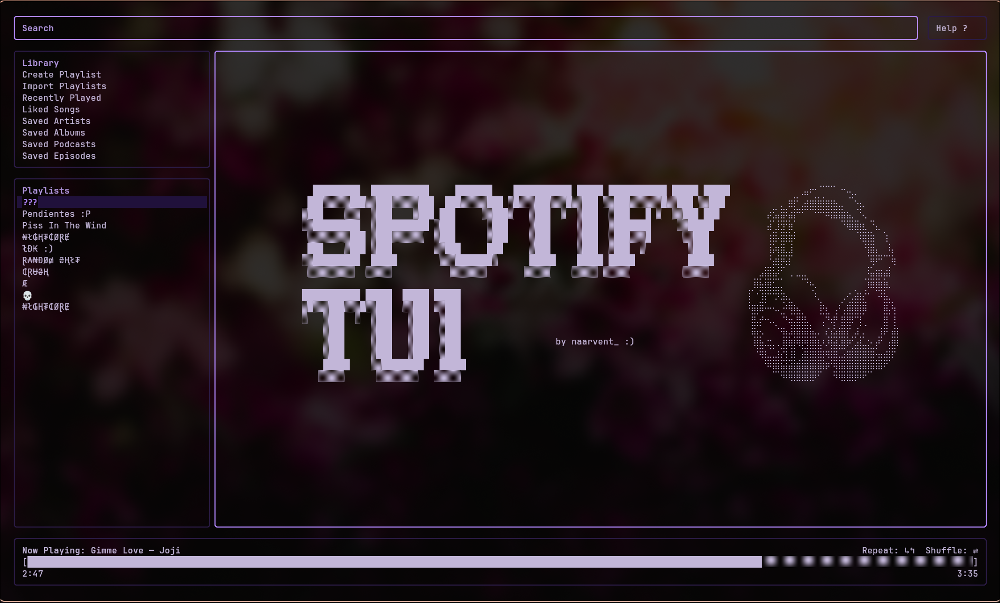
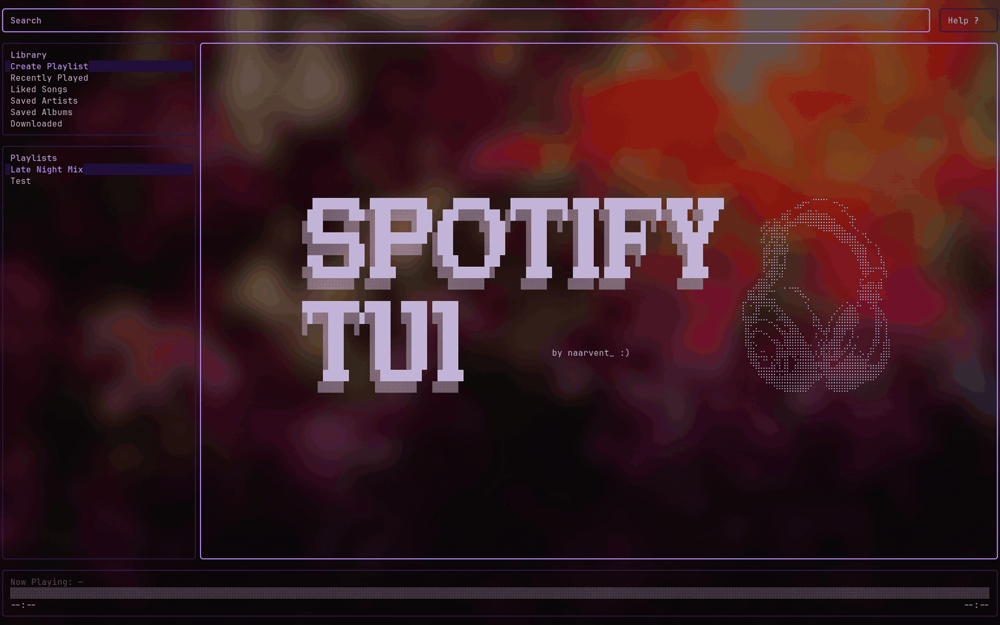
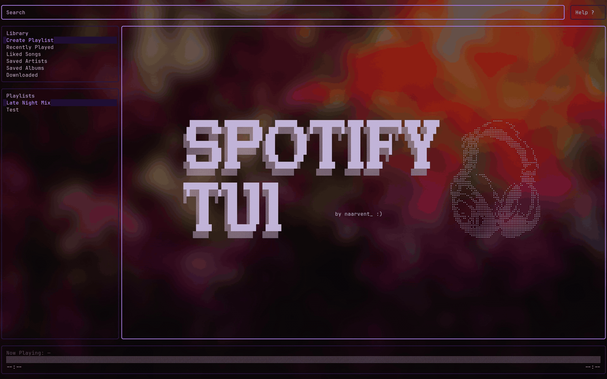

<h1 align="center">Spotify-TUI</h1>

<p align="center">
  <b>One keyboard-driven music player for your terminal.</b><br>
  Spotify, YouTube Music and Subsonic / Navidrome in one interface, with <b>offline downloads</b>.
</p>

<p align="center">
  <a href="https://github.com/naarvent/Spotify-TUI/releases"></a>
  <a href="https://www.python.org/"></a>
  <a href="LICENSE"></a>
  <a href="https://github.com/Textualize/textual"></a>
</p>

<p align="center">
  
</p>

<p align="center">
  <a href="#why-spotify-tui">Why</a> ·
  <a href="#providers-at-a-glance">Providers</a> ·
  <a href="#download-your-music-offline">Offline</a> ·
  <a href="#demo">Demo</a> ·
  <a href="#install">Install</a> ·
  <a href="https://github.com/naarvent/Spotify-TUI/wiki">Wiki</a>
</p>

---

## Why Spotify-TUI

| | |
| --- | --- |
| 🎛️ **Several providers, one interface** | Switch live between Spotify, YouTube Music, Subsonic / Navidrome and Spotify via MPRIS with `P`. The UI shows only what the active provider can do. |
| ⬇️ **Download your music** | Press `o` on a song or `O` on a whole list to keep it offline (YouTube Music and Subsonic). Old copies are pruned automatically once your size cap is reached. |
| 🗂️ **A library without an account** | Likes, saved albums, followed artists and playlists live in a local library. Import your playlists from Spotify. |
| 🎤 **Synced and karaoke lyrics** | Line-by-line lyrics, plus a karaoke mode with word-by-word timing when a word-synced source is available. |
| 📻 **Radio and artist pages** | Start a radio from a song, an artist or a playlist, and open an artist's top tracks, albums and singles. |
| 📊 **Audio visualizer** | Real system audio through `cava`, mirrored or plain bars, up to 60 fps. |
| ⌨️ **Everything from the keyboard** | Filter, sort, queue, devices and help in full-screen views. Transparent background and accent colours, so it fits your terminal. |

> **Status:** `v1.0.1`. The application includes responsive search and tables, reliable cached library and playlist loading, synchronized lyrics, visible action feedback, an experimental built-in local player and a one-click Windows installer, backed by an extensive offline regression suite.

## Providers at a glance

| | Spotify | YouTube Music | Subsonic / Navidrome | Spotify Free (MPRIS) |
| --- | :---: | :---: | :---: | :---: |
| **Account or server** | Spotify account + your own Developer app | none | your own server | Spotify account + Developer app |
| **Search and browse** | ✅ | ✅ | ✅ | ✅ |
| **Playback** | ✅ Premium (local player or Connect) | ✅ `mpv` + `yt-dlp` | ✅ `mpv` | ✅ through your browser / desktop player |
| **Likes, saved albums and artists** | ✅ your account | ✅ local library | ✅ server stars | ✅ your account |
| **Playlists** | ✅ | ✅ local + imported public ones | ✅ | ✅ |
| **Offline downloads** (`o` / `O`) | ❌ no legitimate route | ✅ | ✅ | ❌ |
| **Radio** (`R`) | ❌ endpoint closed to new apps | ✅ | ✅ | ❌ |
| **Artist page** | ✅ albums and singles | ✅ top tracks, albums, related | ✅ albums (top tracks and similar with Last.fm on the server) | ✅ albums and singles |
| **Synced lyrics** | ✅ | ✅ | ✅ | ✅ |

> [!NOTE]
> Offline downloads are not offered for Spotify: it has no download endpoint and its audio is DRM-protected. The `↓` column is shown dimmed there.

Details, setup and limits of each provider are in the wiki: [Providers](https://github.com/naarvent/Spotify-TUI/wiki/Providers).

## Download your music (offline)

Keep what you listen to on your own disk, in the same interface:

- **`o`** downloads the highlighted song (press it again to delete the copy). **`O`** downloads every song of the open list: a playlist, an album, Liked Songs, an artist page or a radio.
- **Library > Downloaded** lists everything you have offline and plays it from the local file, without streaming. Sort it with `s` / `S`.
- A **size cap** (1 GB by default, adjustable in Settings) keeps it tidy: the least recently played copies are removed first.
- Works with **YouTube Music** (best audio available, no re-encoding, via `yt-dlp`) and **Subsonic / Navidrome** (the server's original file).


## Demo

<!-- GIF SLOTS: keep the file names; the demo scripts regenerate them (see assets/demo/). -->

<table>
  <tr>
    <td width="50%"><b>Search and play</b><br><sub>Subsonic / Navidrome</sub><br></td>
    <td width="50%"><b>Library, filter and sort</b><br><sub>Subsonic / Navidrome</sub><br></td>
  </tr>
  <tr>
    <td width="50%"><b>Switch provider live (<code>P</code>)</b><br><sub>Subsonic, YouTube Music and Spotify</sub><br></td>
    <td width="50%"><b>Lyrics and karaoke (<code>k</code>)</b><br><sub>Word-by-word timing</sub><br></td>
  </tr>
  <tr>
    <td width="50%"><b>Visualizer (<code>v</code>)</b><br><sub>cava, up to 60 fps</sub><br></td>
    <td width="50%"><b>Queue, devices and help</b><br><sub>Full-screen views</sub><br></td>
  </tr>
  <tr>
    <td width="50%"><b>Settings and themes</b><br><sub>Transparent background and accent colours</sub><br></td>
    <td width="50%"><b>Coming soon</b><br><sub>Create a playlist, Import from Spotify</sub><br><!-- TODO GIF: assets/demo/create-playlist.gif --><!-- TODO GIF: assets/demo/import-from-spotify.gif --></td>
  </tr>
</table>

## Install

**Windows**: download `SPT-TUI-Setup-<version>.exe` from the [Releases page](https://github.com/naarvent/Spotify-TUI/releases). No Python needed.

**Linux / macOS**:

```bash
pipx install git+https://github.com/naarvent/Spotify-TUI.git
spt
```

Optional pieces, depending on what you use: `mpv` (YouTube Music and Subsonic playback), `yt-dlp` and the `ytmusic` / `subsonic` extras for those providers, `cava` (visualizer) and `librespot` (local Spotify player).
Full steps, including running from source: [Installation](https://github.com/naarvent/Spotify-TUI/wiki/Installation).

## First steps

1. Run `spt`.
2. Press **`P`** and pick a provider.
   - **YouTube Music** needs no account.
   - **Subsonic / Navidrome** needs your server URL and user (Settings, `<`).
   - **Spotify** needs your own [Developer app](https://developer.spotify.com/dashboard) (Client ID and Secret) and Premium for playback. See [Providers](https://github.com/naarvent/Spotify-TUI/wiki/Providers).
3. Type in the **Search** bar, press `Enter` on a song, and press `?` for Help at any time.

<!-- GIF SLOT (optional): assets/demo/first-run.gif, launch, pick a provider, first search -->

## The keys you need

| Key | Action | Key | Action |
| --- | --- | --- | --- |
| `P` | Switch provider | `Space` | Play / pause |
| `/` | Search, or filter the open list | `n` / `p` | Next / previous |
| `Enter` | Open or play | `r` / `Ctrl+S` | Repeat / shuffle |
| `o` / `O` | Download song / whole list | `k` | Karaoke lyrics |
| `R` | Start a radio | `v` | Visualizer |
| `Ctrl+C` | Queue | `d` | Devices |
| `<` | Settings | `?` | Help |

Every key is in the wiki: [Keyboard Shortcuts](https://github.com/naarvent/Spotify-TUI/wiki/Keyboard-Shortcuts).

## What's new in 1.0

- 🎛️ **Providers**: Spotify, YouTube Music, Subsonic / Navidrome and Spotify Free through MPRIS, switchable live.
- ⬇️ **Offline downloads** and a **local library** that needs no account, with **Import from Spotify**.
- 🔎 **Radio**, **artist pages**, a `/` **filter** and Up / Down that wrap around.
- 🎤 **Karaoke lyrics**, with word-by-word timing from the Spicy Lyrics API (your own free key).
- 🎨 **Transparent background**, accent colours, full-screen Queue / Devices / Help, and a cleaner Now Playing bar.
- 📊 **Visualizer** with a configurable default mode and frame rate.

Details: [CHANGELOG.md](CHANGELOG.md).

## Documentation

The full documentation lives in the **[wiki](https://github.com/naarvent/Spotify-TUI/wiki)**:

| | |
| --- | --- |
| [Installation](https://github.com/naarvent/Spotify-TUI/wiki/Installation) | Requirements, installers, pipx, from source, Spotify setup |
| [Providers](https://github.com/naarvent/Spotify-TUI/wiki/Providers) | Setup, limits and capabilities of each provider |
| [Search](https://github.com/naarvent/Spotify-TUI/wiki/Search) | Combined and type-specific search |
| [Offline Downloads](https://github.com/naarvent/Spotify-TUI/wiki/Offline-Downloads) | `o` / `O`, the Downloaded view, the size cap |
| [Lyrics and Karaoke](https://github.com/naarvent/Spotify-TUI/wiki/Lyrics-and-Karaoke) | Synced lyrics, karaoke, Spicy Lyrics |
| [Artist Page and Radio](https://github.com/naarvent/Spotify-TUI/wiki/Artist-Page-and-Radio) | Discover from an artist, a song or a playlist |
| [Visualizer](https://github.com/naarvent/Spotify-TUI/wiki/Visualizer) | cava, modes and frame rate |
| [Keyboard Shortcuts](https://github.com/naarvent/Spotify-TUI/wiki/Keyboard-Shortcuts) | Every key, by view |
| [Local Player](https://github.com/naarvent/Spotify-TUI/wiki/Local-Player) | The built-in Spotify player (librespot) |
| [Limitations and Security](https://github.com/naarvent/Spotify-TUI/wiki/Limitations-and-Security) | What it cannot do and how credentials are kept |
| [Architecture](https://github.com/naarvent/Spotify-TUI/wiki/Architecture) | Code layout and how to run the tests |

## Contributing and security

Issues and pull requests are welcome: read [CONTRIBUTING.md](CONTRIBUTING.md) first. Report vulnerabilities privately, as described in [SECURITY.md](SECURITY.md). Never share tokens, passwords or keys in an issue.

## License

MIT. See [LICENSE](LICENSE).
